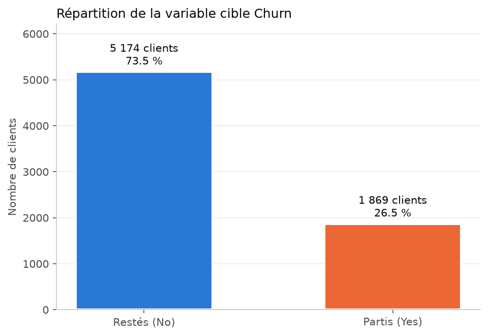

# Partie 1 — Compréhension métier & collecte des données

Responsable : Massamba Fall Séne (Membre 1)

Notebook associé : [`notebooks/01_comprehension_donnees.ipynb`](../notebooks/01_comprehension_donnees.ipynb)

## 1. Le problème du churn

Le *churn* (attrition) désigne le départ d'un client qui résilie son abonnement ou cesse d'utiliser un service. Pour une entreprise de télécommunications, acquérir un nouveau client coûte nettement plus cher que fidéliser un client existant. Identifier à l'avance les clients à risque permet de déclencher des actions ciblées (offre commerciale, appel de fidélisation, changement de contrat).

## 2. Objectif du projet

Construire un modèle de classification binaire qui prédit si un client va quitter l'entreprise (`Churn = Yes`) ou rester (`Churn = No`), puis identifier les facteurs qui influencent le plus ce départ afin de formuler des recommandations métier.

- **Type de tâche** : classification supervisée binaire
- **Variable cible** : `Churn`
- **Métrique clé** : Recall et F1-score sur la classe « churn » (rater un client qui part coûte plus cher que lancer une action inutile), complétés par ROC-AUC

## 3. Dataset retenu

**Telco Customer Churn** (IBM Sample Data, disponible sur Kaggle).

- Fichier : `data/raw/telco_customer_churn.csv` (977 501 octets, CSV séparé par des virgules, ligne d'en-tête)
- **7 043 clients × 21 colonnes** (1 identifiant, 19 variables explicatives, 1 cible), vérifié avec pandas
- Un client par ligne, `customerID` unique
- **1 869 clients churnés (26,54 %)** contre 5 174 restés (73,46 %) → classes **déséquilibrées**
- Empreinte SHA-256 du fichier brut : `88be4b93fbe0cc83421af1c503794c97c342eca914c1576db7c276e61d61358a` (permet de vérifier que tout le monde travaille sur le même fichier : `shasum -a 256 data/raw/telco_customer_churn.csv`)

- **URL source** : <https://www.kaggle.com/datasets/blastchar/telco-customer-churn>
- **Licence** : « Data files © Original Authors » (indiquée par Kaggle ; jeu d'exemple publié à l'origine par IBM). Ce n'est pas une licence libre : usage pédagogique dans le cadre du projet, sans redistribution publique des données. Le dépôt est privé.
- **Date de mise à jour (Kaggle)** : 23 février 2018
- **Taille déclarée par Kaggle** : 977 501 octets, identique à notre fichier

## 4. Description des variables

| Variable | Type | Modalités / plage | Description |
|---|---|---|---|
| customerID | Identifiant | 7 043 valeurs uniques | Identifiant unique du client (à exclure du modèle) |
| gender | Catégorielle | Female, Male | Genre du client |
| SeniorCitizen | Binaire (0/1) | 0, 1 | Client senior ou non |
| Partner | Catégorielle | Yes, No | Vit en couple |
| Dependents | Catégorielle | Yes, No | A des personnes à charge |
| tenure | Numérique (entier) | 0 à 72 mois | Nombre de mois depuis la souscription |
| PhoneService | Catégorielle | Yes, No | Service téléphonique |
| MultipleLines | Catégorielle | Yes, No, No phone service | Plusieurs lignes téléphoniques |
| InternetService | Catégorielle | DSL, Fiber optic, No | Type d'accès internet |
| OnlineSecurity | Catégorielle | Yes, No, No internet service | Option sécurité en ligne |
| OnlineBackup | Catégorielle | Yes, No, No internet service | Option sauvegarde en ligne |
| DeviceProtection | Catégorielle | Yes, No, No internet service | Protection des appareils |
| TechSupport | Catégorielle | Yes, No, No internet service | Support technique |
| StreamingTV | Catégorielle | Yes, No, No internet service | Streaming TV |
| StreamingMovies | Catégorielle | Yes, No, No internet service | Streaming films |
| Contract | Catégorielle | Month-to-month, One year, Two year | Type de contrat |
| PaperlessBilling | Catégorielle | Yes, No | Facturation dématérialisée |
| PaymentMethod | Catégorielle | Electronic check, Mailed check, Bank transfer (automatic), Credit card (automatic) | Mode de paiement |
| MonthlyCharges | Numérique (réel) | 18,25 à 118,75 | Montant facturé par mois |
| TotalCharges | Numérique (stocké en texte) | 18,8 à 8 684,8 (+ 11 valeurs `' '`) | Montant total facturé |
| **Churn** | **Cible** | **Yes, No** | **Le client a-t-il quitté l'entreprise ?** |

## 5. Qualité des données (vérifiée dans le notebook)

| Contrôle | Résultat |
|---|---|
| Lignes dupliquées | 0 |
| `customerID` dupliqués | 0 |
| Valeurs NaN détectées par pandas | 0 |
| `TotalCharges` | lue comme texte ; **11 valeurs** égales à `' '` (un espace), toutes pour des clients avec `tenure = 0` (les 11 seuls clients dans ce cas) |
| Cohérence `TotalCharges` ≈ `tenure` × `MonthlyCharges` | écart relatif médian de 2 % |
| `No internet service` | 1 526 clients, identique sur les 6 variables de services internet |
| `No phone service` (MultipleLines) | 682 clients, égal au nombre de clients avec `PhoneService = No` |

## 6. Points de vigilance à transmettre aux autres membres

- `TotalCharges` est lu comme texte et contient **11 valeurs `' '`**, pour les 11 clients avec `tenure = 0` (pas encore facturés). Convertir avec `pd.to_numeric(..., errors="coerce")` puis imputer par 0 (cohérent métier) ou supprimer ces lignes, en justifiant le choix (partie 3).
- `customerID` ne doit pas servir de variable explicative.
- Classes déséquilibrées (26,5 % / 73,5 %) : un modèle « toujours No » obtient déjà 73,5 % d'accuracy. Stratifier le découpage train/test, utiliser Recall / F1 / ROC-AUC, et n'appliquer un éventuel rééchantillonnage (SMOTE) que sur le jeu d'entraînement.
- Plusieurs services (OnlineSecurity, StreamingTV…) ont une modalité « No internet service », et `MultipleLines` a « No phone service » : information redondante avec `InternetService` / `PhoneService`, à encoder avec soin.
- `SeniorCitizen` est codée 0/1 alors que les autres binaires sont Yes/No : harmoniser l'encodage.
- `TotalCharges`, `tenure` et `MonthlyCharges` sont fortement liées : attention à la multicolinéarité pour les modèles linéaires.
- `requirements.txt` ne fixe pas les versions : le notebook a été exécuté avec pandas 3.1, qui lit le texte en `str` (et non `object`). Sélectionner les colonnes texte avec `select_dtypes(exclude="number")`.
- Ne jamais modifier `data/raw/` : écrire les données préparées dans `data/processed/`.

## 7. Checklist de livraison

- [x] Dataset téléchargé dans `data/raw/`
- [x] Source, licence et date notées dans ce document
- [x] Dimensions et types vérifiés avec pandas (`shape`, `dtypes`)
- [x] Notebook `01_comprehension_donnees.ipynb` exécutable de haut en bas
- [ ] Présentation du problème prête pour l'oral
- [ ] Pull Request ouverte vers `main`
